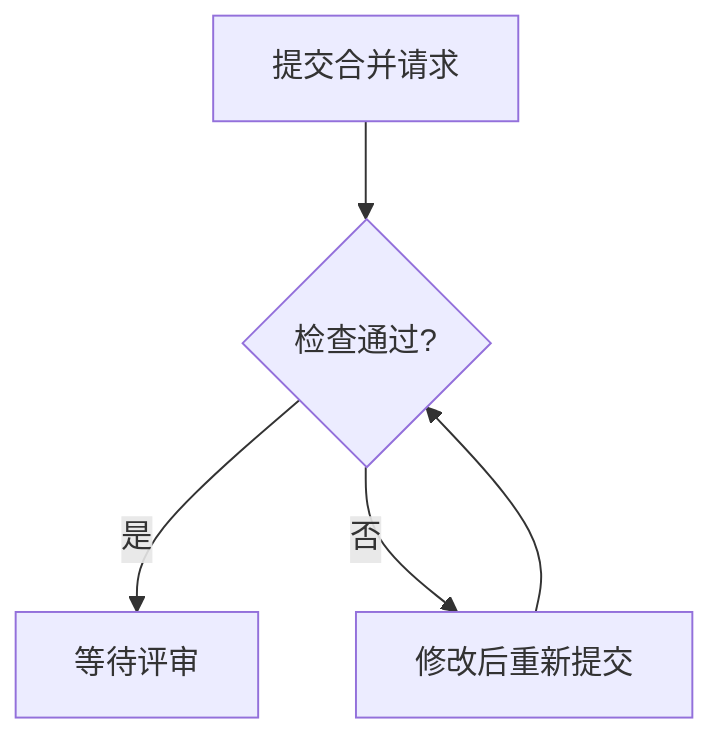

# 块的写法

目录：提示框、状态标签、时间线、指标卡、图表、流程图、小程序、图片、画布、分栏、折叠、脚注、公式、HTML。

照下面的样子写，空格和换行也照抄：改文档时要逐字引用原文，文档存下来就是这个样子。写错了，写入会被拒，返回里写着哪一行、正确的写法是什么。

## 提示框

```
> [!IMPORTANT]
> 推荐方案 A：现成的扩展最多，一个月能上线。
```

类型：NOTE（补充）、TIP（建议）、IMPORTANT（结论、决定）、WARNING（风险）、CAUTION（会出事的操作）。一篇文档里提示框不超过三个。

## 状态标签

`{✓ 文字}` 表示是、通过、会发生；`{✗ 文字}` 表示否、不通过、不会发生；`{! 文字}` 表示有风险、待定。正文、表格、时间线里都能用。

## 时间线

每项写「时间或序号 | 标题」，下一行缩进两格写一两句说明，说明可以不写；标题后面可以跟状态标签。

```
:::timeline
- 10:02 | 提交合并请求 {✓ 单元测试} {✗ 类型检查}
  类型检查报了 2 处错误。
- 10:15 | 修好后重新提交 {✓ 单元测试} {✓ 类型检查} {! 等待评审}
:::
```

## 指标卡

每行写「名称 | 数值 | 变化」，变化可以不写；最多六项。

```
:::stats
- 活跃项目 | 128 | +12%
- 首字时间 | 6.1 秒 | -27%
:::
```

## 图表

里面只放一张表格：第一列是横轴或分类，其余每列是一组数。格子里只写数，可以带 , % 和货币符号，单位写进表头。

```
:::chart line
| 周     | 改版前（次） | 改版后（次） |
| ----- | ------ | ------ |
| 第 1 周 | 1,020  | 1,980  |
| 第 2 周 | 1,060  | 2,150  |
| 第 3 周 | 1,070  | 2,290  |
:::
```

类型：bar（比大小）、line（看趋势）、area（看趋势和总量）、stacked（比总量和组成）、pie（看占比，表格只有两列）、scatter（看两个数的关系，第一列也是数）。分类名长或项目多时写 `:::chart bar horizontal`，柱子横着画。饼图、柱状图、折线图都用图表块，不用 mermaid 的 pie 和 xychart。

## 流程图

用 mermaid，只用 flowchart、sequenceDiagram、gantt、stateDiagram：



一张图不超过 8 个节点，从上往下画（TD），每个判断最多两条分支，节点里的字不超过 10 个。带具体时刻的事件用时间线块，不用 mermaid 的 timeline。

## 小程序

读者动一动、看它动起来才更快明白的内容用小程序：看懂原理、改条件试结果、比方案、按时间推演、做练习。代码不写在文档里：先用 `cheese_app_save` 交代码，它返回块的开头一行，放进文档：

```
:::app q7m2kx4t@3 并发数对排队时间的影响
拖动并发数，看排队时间和花费怎么变：超过 8 以后，排队时间几乎不再缩短。
:::
```

第一行是短号、版本和标题，照工具给的抄，不要自己编。中间一句话说清它展示什么、结论是什么。代码怎么写见 `references/apps.md`。

## 图片

图表块和 mermaid 都画不出来的，用 Python（matplotlib）画成 PNG。机器上没装 matplotlib 时，用 `uv run --with matplotlib python 画图.py` 临时装上。图里有中文时，建议加载机器上的中文字体，不然中文会显示成方框：

```python
import os
import matplotlib.pyplot as plt
from matplotlib import font_manager

font_manager.fontManager.addfont(os.path.join(os.environ["TYPST_FONT_PATHS"], "NotoSansSC-VF.otf"))
plt.rcParams["font.family"] = "Noto Sans SC"
```

图存在工作目录里，不用提交。用 `cheese show figures/耗时.png` 摆出来（它也会成为任务的预览），再在任务的实况文档里用同一个路径引用：

```

```

能读这份文档的人都看得到这张图。项目文档只显示资料库里的图，写成 ``；你放不进资料库，需要的话请人在摆出来的那张图上按「保存到资料库」。

## 画布

要让没参与讨论的人看清几件事之间的关系，比如谁等谁、谁影响谁、哪几件是为了同一个目标，可以在文档里放一块画布：格子摆在一块板上，格子之间连线。一句话或一张表说得清的，不用画布。

先在文档里写这样一段，`new` 占住编号的位置，后面跟标题，下一行用一句话说这块画布讲什么：

```
:::canvas new 项目地图
各件事和它们之间的关系。
:::
```

写进文档后，平台建好这块画布，把 `new` 换成它的编号，写入的返回里也会告诉你编号。之后用 `cheese_canvas_edit` 加格子、连线、挪位置，用 `cheese_canvas_get` 读它现在的样子；读文档时，画布的文字版跟在正文后面。

- 格子里是一段 Markdown，可以缩进分层。写什么由你定：一件事、一个目标、一张便签都行。格子可以关联一个任务，读的人点一下就到任务那里，也看得到任务的状态。
- 连线上可以写一句话，说清两件事是什么关系，比如「做完才能」「会影响」；不写也行。
- 不给位置的格子，平台按连线自动摆。
- 人刚改过或挪过的格子，读的时候会注明是谁改的。你也可以改它，改之前想想人为什么那样改。
- 改文档时这一段照原样留着，编号不要改。把它抄进另一份文档，得到的是一块独立的新画布，两边各改各的。

## 分栏

两到三栏：

```
::::columns
:::column
**方案 A**

一个月上线。
:::
:::column
**方案 B**

两周上线。
:::
::::
```

## 折叠

```
<details><summary>原始数据</summary>

这里写 Markdown 内容。

</details>
```

## 脚注

正文写 `[^1]`，文末单独一行写 `[^1]: 说明`。脚注只做两件事：解释一个名词，写出一个数的来源或算式。免责、补充论点、「仅供参考」都不写进脚注。

## 公式

行内写 `$...$`，单独一段写

```
$$
E = mc^2
$$
```

金额里的 `$` 照常写：`$` 后面紧跟数字的不算公式。

## HTML

除了 details、summary、sub、sup、kbd、br、mark，不要用其他 HTML 标签。
