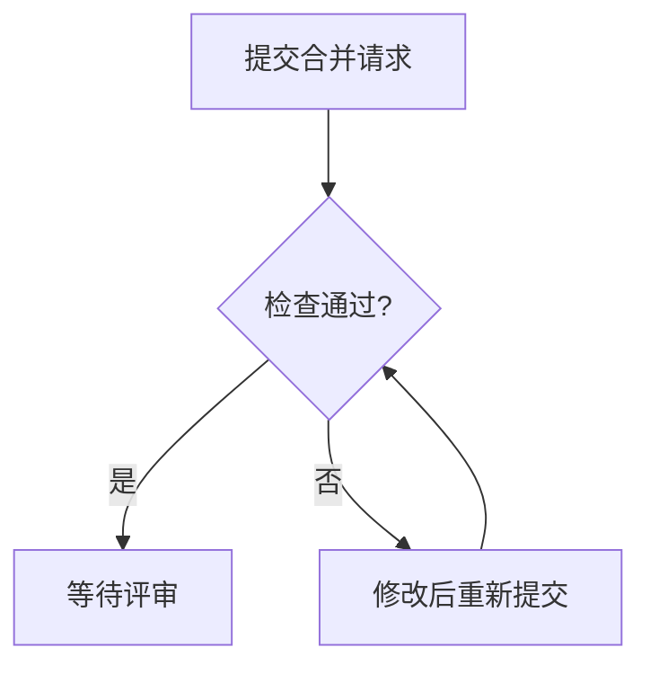

# 块的写法

目录：提示框、状态标签、时间线、指标卡、图表、流程图、小程序、图片、画布、分栏、折叠、脚注、公式、HTML。

按下面的格式书写，空格和换行也保持一致：修改文档时要逐字引用原文，文档保存后就是这个格式。格式写错时，写入会被拒绝，返回的信息中会指出是哪一行、正确的写法是什么。

## 提示框

```
> [!IMPORTANT]
> 推荐方案 A：现成的扩展最多，一个月能上线。
```

类型：NOTE（补充）、TIP（建议）、IMPORTANT（结论、决定）、WARNING（风险）、CAUTION（可能造成损失的操作）。一份文档中的提示框不超过三个。

## 状态标签

`{✓ 文字}` 表示是、通过、会发生；`{✗ 文字}` 表示否、不通过、不会发生；`{! 文字}` 表示有风险、待定。正文、表格、时间线中都可以使用。

## 时间线

每项写「时间或序号 | 标题」，下一行缩进两格，写一两句说明，说明可以省略；标题后面可以加状态标签。

```
:::timeline
- 10:02 | 提交合并请求 {✓ 单元测试} {✗ 类型检查}
  类型检查报了 2 处错误。
- 10:15 | 修好后重新提交 {✓ 单元测试} {✓ 类型检查} {! 等待评审}
:::
```

## 指标卡

每行写「名称 | 数值 | 变化」，变化可以省略；最多六项。

```
:::stats
- 活跃项目 | 128 | +12%
- 首字时间 | 6.1 秒 | -27%
:::
```

## 图表

块中只放一张表格：第一列是横轴或分类，其余每列是一组数据。单元格中只写数字，可以带千位分隔符、% 和货币符号，单位写在表头中。

```
:::chart line
| 周     | 改版前（次） | 改版后（次） |
| ----- | ------ | ------ |
| 第 1 周 | 1,020  | 1,980  |
| 第 2 周 | 1,060  | 2,150  |
| 第 3 周 | 1,070  | 2,290  |
:::
```

类型：bar（比较大小）、line（观察趋势）、area（观察趋势和总量）、stacked（比较总量和组成）、pie（观察占比，表格只有两列）、scatter（观察两个数之间的关系，第一列也是数字）。分类名称较长或项目较多时，写 `:::chart bar horizontal`，柱子横向排列。饼图、柱状图、折线图都用图表块，不用 mermaid 的 pie 和 xychart。

## 流程图

用 mermaid，只使用 flowchart、sequenceDiagram、gantt、stateDiagram：



一张图不超过 8 个节点，从上往下排列（TD），每个判断最多两条分支，节点中的文字不超过 10 个字。带具体时刻的事件用时间线块，不用 mermaid 的 timeline。

## 小程序

什么时候用小程序、代码怎么写，见 `miniapp` 技能。代码不写在文档中：先用 `cheese_app(action=save)` 提交代码，它返回整个块的写法，把它放进文档：

```
:::app q7m2kx4t@3 并发数对排队时间的影响
拖动并发数，观察排队时间和花费的变化：并发数超过 8 以后，排队时间几乎不再缩短。
:::
```

第一行是短号、版本和标题，照工具返回的内容填写，不要自行编造。中间用一句话写明它展示什么、结论是什么。

## 图片

图表块和 mermaid 都画不出来的，用 Python（matplotlib）画成 PNG。机器上没有安装 matplotlib 时，用 `uv run --with matplotlib python 画图.py` 临时安装。图中有中文时，加载机器上的中文字体，否则中文会显示成方框：

```python
import os
import matplotlib.pyplot as plt
from matplotlib import font_manager

font_manager.fontManager.addfont(os.path.join(os.environ["TYPST_FONT_PATHS"], "NotoSansSC-VF.otf"))
plt.rcParams["font.family"] = "Noto Sans SC"
```

图片保存在工作目录中，不需要提交。用 `cheese show figures/耗时.png` 展示（它也会成为任务的预览），再在任务的实况文档中用同一个路径引用：

```

```

能阅读这份文档的人都能看到这张图。项目资料库中的文档只显示资料库里的图片，写成 ``；你无法把图片放进资料库，需要时请人在展示出的图片上点击「保存到资料库」。

## 画布

需要让没有参与讨论的人看清几件事之间的关系时，例如谁依赖谁、谁影响谁、哪几件服务于同一个目标，可以在文档中放一块画布：格子排列在一块板上，格子之间用线连接。一句话或一张表能说清的，不用画布。

先在文档中写这样一段：`new` 占据编号的位置，后面是标题，下一行用一句话写明这块画布表达什么：

```
:::canvas new 项目地图
各件事和它们之间的关系。
:::
```

写入文档后，平台会创建这块画布，把 `new` 替换为它的编号，写入的返回信息中也会给出编号。之后用 `cheese_canvas(action=edit)` 添加格子、连线和调整位置，用 `cheese_canvas(action=get)` 读取它当前的状态；读取文档时，画布的文字版附在正文之后。

- 格子中是一段 Markdown，可以缩进分层。内容由你决定：一件事、一个目标或一张便签都可以。格子可以关联一个任务，读者点击即可打开该任务，也能看到任务的状态。
- 连线上可以写一句话，说明两件事的关系，例如「完成后才能开始」「会影响」；也可以不写。
- 没有指定位置的格子，平台按连线自动排列。
- 人刚修改或移动过的格子，读取时会注明修改者。你也可以修改它，修改前先考虑对方为什么那样改。
- 修改文档时，这一段保持原样，不要改动编号。把它复制到另一份文档，得到的是一块独立的新画布，两边的修改互不影响。

## 分栏

两栏或三栏：

```
::::columns
:::column
**方案 A**

一个月上线。
:::
:::column
**方案 B**

两周上线。
:::
::::
```

## 折叠

```
<details><summary>原始数据</summary>

这里写 Markdown 内容。

</details>
```

## 脚注

正文中写 `[^1]`，文末单独一行写 `[^1]: 说明`。脚注只用于两件事：解释一个名词，写出一个数的来源或算式。免责说明、补充论点、「仅供参考」都不写进脚注。

## 公式

行内公式写 `$...$`，单独成段的公式写

```
$$
E = mc^2
$$
```

金额中的 `$` 照常书写：`$` 后面紧跟数字时，不视为公式。

## HTML

除 details、summary、sub、sup、kbd、br、mark 外，不使用其他 HTML 标签。
